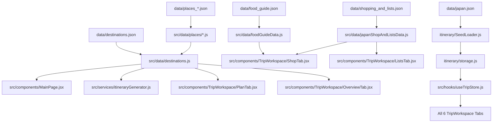

# WanderWise / Adeon — File Distribution & Architecture Map

This document serves as the comprehensive architectural reference and file distribution map for the **WanderWise / Adeon** travel planning web application. It outlines the directory structure, the purpose and responsibility of every file, and details the centralized JSON data system.

---

## 1. Directory Structure Overview

Below is the complete project tree:

```text
iternar-folder/
├── data/                                 # Centralized JSON data files (editable data hub)
│   ├── destinations.json                 # 5 destination metadata configs (Shimla, Jaipur, Japan, Dubai, Chandigarh)
│   ├── food_guide.json                   # Curated authentic food items for all destinations
│   ├── japan.json                        # Default demo trip seed dataset (complete 6-tab state)
│   ├── map_style.json                    # MapLibre GL vector & raster map styling configuration
│   ├── places_chandigarh.json            # 7 verified places for Chandigarh
│   ├── places_dubai.json                 # 7 verified places for Dubai
│   ├── places_jaipur.json                # 7 verified places for Jaipur
│   ├── places_japan.json                 # 7 verified places for Japan (Tokyo & Kyoto)
│   ├── places_shimla.json                # 7 verified places for Shimla
│   ├── shopping_and_lists.json           # Curated shopping items, shopping guide, & packing checklists
│   ├── trips.json                        # Initial trips container schema
│   └── seeds/
│       └── japan.json                    # Backward-compatible mirror of japan.json
├── docs/                                 # Architectural & Technical Documentation
│   ├── API_CONTRACT.md                   # External & internal API specifications
│   ├── DATA_MODEL.md                     # Storage schemas & data entities
│   ├── FEATURE_MATRIX.md                 # Tab-by-tab feature verification matrix
│   ├── FILE_DISTRIBUTION.md              # This file: Project organization & distribution map
│   ├── IMPLEMENTATION_PLAN.md            # Rebuild roadmap and phase breakdowns
│   ├── SYSTEM_MAP.md                     # Component hierarchy and data flow architecture
│   └── TEST_PLAN.md                      # Vitest test matrix and coverage requirements
├── itinerary/                            # Data Access Layer & Repositories
│   ├── ExpenseRepository.js              # CRUD and budget operations for trip expenses
│   ├── PackingRepository.js              # CRUD and check state for packing list items
│   ├── PlaceRepository.js                # CRUD for saved places and bookmarks
│   ├── SeedLoader.js                     # Idempotent loading and reset of initial Japan trip
│   ├── ShopGuideRepository.js            # CRUD and collected/tried tracking for shop items
│   ├── TodoRepository.js                 # CRUD for to-do items
│   ├── TransportRepository.js            # CRUD for flights, trains, and inter-city transit
│   ├── TripRepository.js                 # High-level trip lifecycle (create, duplicate, archive, delete)
│   ├── VisitRepository.js                # Scheduling, stop reordering, and day itineraries
│   ├── calculations.js                   # Haversine distance, budget totals, and analytics
│   ├── data.js                           # Core data re-exports
│   ├── ids.js                            # Secure UUID and nano ID generation
│   ├── index.js                          # Public domain facade
│   ├── storage.js                        # Unified localStorage adapter with error boundaries
│   └── types.js                          # JSDoc type contracts
├── server/                               # Optional Express.js API Proxy
│   └── index.js                          # Unsplash image search and weather proxy with fallbacks
├── src/                                  # Frontend React Application (Vite 8 + React 19)
│   ├── App.jsx                           # Top-level URL routing (/ and /trips/:id)
│   ├── index.css                         # Global CSS tokens, reset, and Aurora styling
│   ├── main.jsx                          # React application entry point
│   ├── assets/                           # Static media and local icons
│   ├── components/                       # React UI Components
│   │   ├── EmptyTripSection.jsx          # Zero-state placeholder for empty trip cards
│   │   ├── FloatingAurora.jsx            # Ambient animated mesh background
│   │   ├── MainPage.css                  # Styles for home page and trip creation
│   │   ├── MainPage.jsx                  # Trip creation form & "My Trips" dashboard
│   │   ├── ShoppingTab.jsx               # Shopping summary wrapper
│   │   ├── SourceTabs.jsx                # Legacy source switcher tab
│   │   ├── TripApp.jsx                   # Trip workspace container & navigation
│   │   ├── TripIcon.jsx                  # Shared SVG iconography
│   │   ├── TripLists.jsx                 # Packing and Todo list container
│   │   ├── TripOverview.jsx              # Hero overview card & ticket pass
│   │   ├── TripPlan.jsx                  # Map and daily itinerary accordion
│   │   ├── TripTabs.jsx                  # Tab navigation header
│   │   ├── trip.css                      # Unified trip workspace stylesheet
│   │   ├── TripWorkspace/                # Native tab implementations
│   │   │   ├── CostTab.css               # Expense manager & budget breakdown styles
│   │   │   ├── CostTab.jsx               # Budget analysis, category bars, expense modal
│   │   │   ├── ListsTab.css              # Packing checklist & Todo styles
│   │   │   ├── ListsTab.jsx              # Interactive checkboxes, categories, progress bar
│   │   │   ├── OverviewTab.css           # Trip hero card & pass ticket styles
│   │   │   ├── OverviewTab.jsx           # Pass ticket, Atlas stats, mock currency converter
│   │   │   ├── PlanIcon.jsx              # Map and pin SVG icons
│   │   │   ├── PlanTab.css               # MapLibre GL map & itinerary accordion styles
│   │   │   ├── PlanTab.jsx               # Interactive map, stop reordering, saved places
│   │   │   ├── ShopTab.css               # Food and shopping guide styles
│   │   │   ├── ShopTab.jsx               # Food guide, shopping items, tried/bought state
│   │   │   ├── TransportTab.css          # Transit cards & timeline styles
│   │   │   └── TransportTab.jsx          # Flights, bullet trains, transfer timeline
│   │   └── ui/                           # Reusable atomic UI primitives
│   ├── data/                             # Data Adapters (Imports from root data/ JSON hub)
│   │   ├── destinations.js               # Combines destinations.json with normalized places
│   │   ├── foodGuideData.js              # Exports food guide functions backed by food_guide.json
│   │   ├── japanShopAndListsData.js      # Exports shopping & list items backed by shopping_and_lists.json
│   │   └── places/                       # Destination place adapters
│   │       ├── chandigarh.js             # Exports places_chandigarh.json
│   │       ├── dubai.js                  # Exports places_dubai.json
│   │       ├── jaipur.js                 # Exports places_jaipur.json
│   │       ├── japan.js                  # Exports places_japan.json
│   │       └── shimla.js                 # Exports places_shimla.json
│   ├── hooks/                            # Custom React Hooks
│   │   └── useTripStore.js               # Unified subscription hook for reactive trip state
│   ├── lib/                              # Client-side helpers and utilities
│   └── services/                         # Client-side Business Logic
│       ├── imageService.js               # Frontend image search service (proxy + Unsplash)
│       └── itineraryGenerator.js         # Multi-day itinerary generator & place distributor
├── tests/                                # Automated Vitest Test Suites
│   ├── integration/                      # Integration Test Suites
│   │   └── tripWorkflow.test.js          # Full end-to-end trip lifecycle tests
│   └── unit/                             # Unit Test Suites
│       ├── phase4DestinationsAndCosts.test.js # Multi-destination & generator unit tests
│       └── repositories.test.js          # Storage & CRUD repository unit tests
├── .env                                  # Local environment secrets (gitignored)
├── .env.example                          # Example environment configuration
├── .gitignore                            # Git file exclusion rules
├── .oxlintrc.json                        # Oxlint code linter configuration
├── index.html                            # Single Page Application HTML entry point
├── package.json                          # Project dependencies, scripts, and engine specs
├── package-lock.json                     # Locked dependency tree
├── README.md                             # User guide, commands, and feature walkthrough
└── vite.config.js                        # Vite 8 build and plugin configuration
```

---

## 2. Centralized Data Directory (`data/`)

All data files that configure destinations, places, demo itineraries, food, shopping, and map styles are consolidated in the `data/` folder as standard JSON. This makes it easy for non-programmers and content creators to update or extend application data without touching JavaScript code.

| File Name | Purpose | Key Attributes / Schema |
|---|---|---|
| `data/destinations.json` | Master destination catalog with geography, currencies, and budgets. | `id`, `name`, `title`, `country`, `region`, `currency`, `currencySymbol`, `defaultBudget`, `coordinates: {lat, lng}`, `zoom`, `heroImage`, `description` |
| `data/japan.json` | Default initial demo trip seed data loaded on fresh installations. | `trip`: metadata, dates, budget; `places`: 7 places; `visits`: scheduled stops; `expenses`: categorized costs; `transport`: transit records; `notes`: trip tips; `shopItems`: shopping list |
| `data/trips.json` | Container file schema for persisted trips index. | `{ "trips": [] }` |
| `data/map_style.json` | MapLibre GL vector and raster styling specification. | MapLibre GL style v8 schema with raster tile sources, fill/stroke layers, fonts, and road casings. |
| `data/places_chandigarh.json` | 7 curated and verified places in Chandigarh. | `id`, `destinationId`, `name`, `category`, `description`, `imageUrl`, `rating`, `estimatedCost`, `currency`, `latitude`, `longitude`, `tags` |
| `data/places_dubai.json` | 7 curated and verified places in Dubai. | Matches place schema with Dubai geo-coordinates (Burj Khalifa, Dubai Mall, Palm Jumeirah, etc.). |
| `data/places_jaipur.json` | 7 curated and verified places in Jaipur (Pink City). | Matches place schema with Jaipur geo-coordinates (Hawa Mahal, Amber Fort, Jantar Mantar, etc.). |
| `data/places_japan.json` | 7 curated and verified places in Tokyo & Kyoto. | Matches place schema with Tokyo geo-coordinates (Sensō-ji, Skytree, Shibuya Crossing, etc.). |
| `data/places_shimla.json` | 7 curated and verified places in Shimla (Himalayas). | Matches place schema with Shimla geo-coordinates (The Ridge, Mall Road, Jakhoo Temple, etc.). |
| `data/food_guide.json` | Regional authentic culinary guide for all 5 destinations. | Destination keys (`japan`, `shimla`, `jaipur`, `dubai`, `chandigarh`) mapping to arrays of `{ id, name, category, emoji, tagLine, story, whereToFind, tip, gradientColors, imageUrl, tried }` |
| `data/shopping_and_lists.json` | Curated souvenir items, accordion shopping guides, and packing categories. | `extraShopItems`: souvenir items; `accordionGuide`: shopping & dining tips; `initialPackingCategories`: checklist templates with clothing, electronics, documents, and accessories |

---

## 3. How Data Flows from `data/` to the React UI

The application uses thin ES module data adapters in `src/data/` that import directly from `data/*.json`:



---

## 4. How to Modify or Extend Data

### 4.1 Modifying or Adding Places
To add or modify an existing place:
1. Open the target JSON file in `data/`, e.g. `data/places_dubai.json`.
2. Add a new object following the standard schema:
```json
{
  "id": "dubai-miracle-garden",
  "destinationId": "dubai",
  "name": "Dubai Miracle Garden",
  "city": "Dubai",
  "country": "United Arab Emirates",
  "category": "nature",
  "description": "World's largest natural flower garden with 150 million blooming flowers.",
  "imageUrl": "https://images.unsplash.com/...",
  "rating": 4.8,
  "reviewCount": 950,
  "estimatedDurationMinutes": 90,
  "estimatedCost": 75,
  "currency": "AED",
  "latitude": 25.0597,
  "longitude": 55.2443,
  "tags": ["flowers", "garden", "nature", "photography"],
  "isDemo": true
}
```
3. Save the file. The Vite development server automatically reloads, and the itinerary generator and Saved Places panel will immediately reflect the new place.

### 4.2 Adding a New Destination
1. Open `data/destinations.json`.
2. Add your destination entry (e.g. `"paris"` or `"london"`):
```json
"paris": {
  "id": "paris",
  "name": "Paris",
  "title": "City of Light, Paris",
  "country": "France",
  "region": "Île-de-France",
  "currency": "EUR",
  "currencySymbol": "€",
  "defaultBudget": 2200,
  "coordinates": { "lat": 48.8566, "lng": 2.3522 },
  "zoom": 12,
  "heroImage": "https://images.unsplash.com/...",
  "description": "The capital of France celebrated for world-class art, fashion, gastronomy, and culture."
}
```
3. Create `data/places_paris.json` containing at least 7 verified places.
4. Create the corresponding adapter in `src/data/places/paris.js` importing the JSON file.
5. Register the new destination in `src/data/destinations.js`.

### 4.3 Editing Regional Food or Shopping Guides
1. Open `data/food_guide.json` to change food items, prices, tips, or emojis.
2. Open `data/shopping_and_lists.json` to edit souvenir recommendations or packing list templates.

---

## 5. Summary of Key Files

| Folder | Core Functionality | Primary Tech / Tools |
|---|---|---|
| `data/` | Centralized JSON source of truth for destinations, places, guides, and map style | JSON |
| `docs/` | System architecture, data contracts, and implementation blueprints | Markdown |
| `itinerary/` | Domain logic, local persistence engine, and calculations | JavaScript (ESM), localStorage |
| `server/` | Lightweight backend proxy for weather and image search | Node.js, Express |
| `src/` | Single-page React user interface | React 19, Vite 8, CSS |
| `tests/` | Unit and integration test suites | Vitest |
