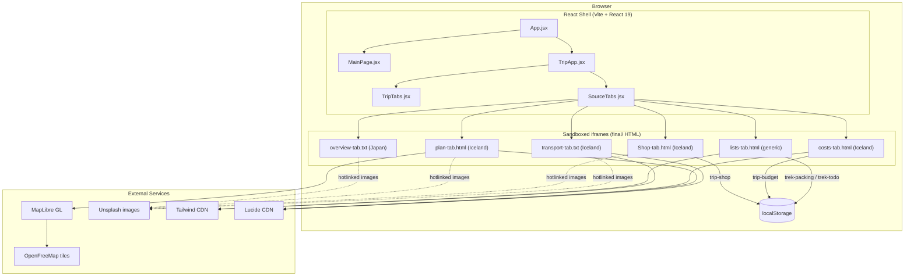

# SYSTEM MAP

> **Adeon / TREK Trips** — Travel-planning web application
> Audited: 2026-10-16 | Status: Pre-connection (UI-only, no coherent persistence)

---

## 1. Product Purpose

Adeon is a personal travel-planning tool. Users create trips, build day-by-day
itineraries with a map, track a food & shopping guide, manage packing and to-do
lists, record costs, and log transport bookings. The design goal is a premium
single-page experience.

---

## 2. Technology Stack

| Layer | Choice | Notes |
|---|---|---|
| Framework | React 19 (+ React Compiler via Babel) | @vitejs/plugin-react, babel-plugin-react-compiler |
| Build tool | Vite 8 | Port 5174, strictPort true |
| Language | JavaScript (JSX) | No TypeScript |
| Routing | Manual (window.history.pushState, popstate) | Two routes only: / and /trips |
| State | React useState (local, per-component) | No global store, no context |
| Styling | Vanilla CSS (shell) + Tailwind CDN (inside iframes) | See section 9 |
| Persistence | localStorage fragmented across 4 keys | No backend, no auth |
| Linter | oxlint | .oxlintrc.json present |
| Tests | None | No test framework installed |
| Backend | None | |
| Auth | None | Local demo only |
| Database | None | |

---

## 3. Screen Inventory

### 3.1 Main Page (/)
File: final/iternary.txt (raw HTML loaded into an iframe)
Component: src/components/MainPage.jsx

Displays:
- Page header ("Make every journey unforgettable")
- Itinerary Info form: destination (hardcoded "Japan"), description, cover image
  upload, interactive date-range picker (calendar), number of days (read-only
  derived), budget, tags
- My Trips section: one hardcoded Japan trip card + "New Trip" button
- Per-card buttons: Edit, Duplicate, Archive, Delete (all UI-only)
- Filter tabs: Planned / Archived / Completed (UI-only)
- Calendar-subscribe button (UI-only)

### 3.2 Trip Workspace (/trips)
Component: src/components/TripApp.jsx
Contains a shared tab bar (TripTabs.jsx) rendering one of six tabs:

| Tab ID    | Label     | Source file               |
|-----------|-----------|---------------------------|
| overview  | Overview  | final/overview-tab.txt    |
| plan      | Plan      | final/plan-tab.html       |
| shop      | Shop      | final/Shop-tab.html       |
| lists     | Lists     | final/lists-tab.html      |
| cost      | Cost      | final/costs-tab.html      |
| transport | Transport | final/transport-tab.txt   |

Each tab is an <iframe srcDoc={html}> sandboxed with allow-scripts, allow-forms,
allow-popups, allow-downloads. The in-iframe navigation bars are hidden via CSS
injection in SourceTabs.jsx.

---

## 4. Navigation and Route Map

  / (MainPage)
    "Save Itinerary" OR trip card click
      window.postMessage -> App.jsx
        navigate('trips', { overviewThenPlan: true })
          /trips (TripApp, starts on overview tab)

  /trips (TripApp)
    Back button -> navigate('main') -> /
    Tab bar: overview | plan | shop | lists | cost | transport

No trip ID appears in the URL. All tabs always show the same hardcoded content.
There is no trip-selection mechanism.

---

## 5. Component Relationships

  App.jsx
  +-- MainPage.jsx           <- iframe of final/iternary.txt
  |   +-- FloatingAurora.jsx
  +-- TripApp.jsx
      +-- TripTabs.jsx
      |   +-- TripIcon.jsx
      +-- SourceTabs.jsx     <- one iframe per tab
          +-- OverviewTab    <- final/overview-tab.txt
          +-- PlanTab        <- final/plan-tab.html
          +-- ShopTab        <- final/Shop-tab.html
          +-- ListsTab       <- final/lists-tab.html
          +-- CostTab        <- final/costs-tab.html
          +-- TransportTab   <- final/transport-tab.txt

UNUSED React components (present but not mounted):
  TripOverview.jsx    -- sample trips Kyoto/Lisbon/Copenhagen, hardcoded stats
  TripPlan.jsx        -- add-place dialog, 7-day selector, SVG map illustration
  TripLists.jsx       -- packing/to-do list UI
  EmptyTripSection.jsx -- empty-state for budget/transport
  ShoppingTab.jsx     -- placeholder "Make Shopping Now"

These appear to be an earlier React-native reimplementation abandoned in favour
of the iframe approach.

---

## 6. Data Flow (Current -- broken)

  localStorage['trek-itinerary']
       |
       | read by
       v
  itinerary/data.js (readItinerary / writeItinerary)
       |
       | BUT data.js is NOT imported by any component
       v
  All tab content is entirely hardcoded inside the final/ HTML files

itinerary/trips.json contains: {"trips": []}
data.js and trips.json exist but are NEVER consumed by the running application.

Per-tab in-memory state:
  iternary.txt       -- form values, calendar, tags (no persistence)
  overview-tab.txt   -- Japan trip hero, Atlas stats (no persistence)
  plan-tab.html      -- P[] places (Iceland), DAYS[] itinerary (no persistence)
  Shop-tab.html      -- FOOD[], SHOP[] (Iceland) -> localStorage['trip-shop']
  lists-tab.html     -- packingCategories[], todoTasks[] -> localStorage['trek-packing'], ['trek-todo']
  costs-tab.html     -- E[] expenses (Iceland) -> localStorage['trip-budget'] (budget only)
  transport-tab.txt  -- transports[] (Iceland Icelandair) (no persistence)

Each iframe is an isolated browsing context. They cannot share state.

---

## 7. Destination Mismatch (The Core Problem)

  Main page form         -> Japan (hardcoded value)
  Main page trip card    -> Japan (Unsplash Japan photo)
  Overview tab           -> "Japan in Autumn" (hardcoded hero)
  Plan tab map           -> Iceland (centre [-18.6, 64.9], 23 Iceland places)
  Shop tab               -> Iceland (ISK prices, Icelandic foods/items)
  Costs tab              -> Iceland (ISK budget 800,000, Icelandair expenses)
  Transport tab          -> Iceland (Icelandair FI519/FI518, KEF, Blue Car Rental)
  Unused TripOverview    -> Kyoto / Lisbon / Copenhagen

---

## 8. Persistence Architecture

Current:
  localStorage
    'trek-itinerary'  -- schema defined in data.js, NEVER WRITTEN by app
    'trip-shop'       -- {[item_id]: boolean} (mark-as-bought)
    'trip-budget'     -- single number
    'trek-packing'    -- full packing JSON
    'trek-todo'       -- full to-do JSON

No unified persistence. Each tab independently manages its own keys.
Changes in one tab are invisible to all other tabs.

Intended schema (from itinerary/data.js, never used):
  { places:[], packing:[], tasks:[], budget:[], transportation:[], trips:[] }

---

## 9. Styling Architecture

  React shell        -- Vanilla CSS: src/index.css, trip.css, MainPage.css
  Plan / Cost tabs   -- Inline <style> blocks (Vanilla CSS)
  Lists / Transport  -- Tailwind CDN + inline <style>
  Shop tab           -- Inline <style> (Vanilla CSS, custom icon system)
  Main page iframe   -- Tailwind CDN + custom properties

Tailwind CDN is runtime-loaded inside iframes. Not suitable for production.
No build-time Tailwind is configured.

---

## 10. External Integrations

| Service            | Tab(s)            | Purpose              | Auth     | Metered |
|--------------------|-------------------|----------------------|----------|---------|
| OpenFreeMap        | plan              | Map base tiles       | None     | No      |
| ESRI World Imagery | plan              | Satellite layer      | None     | ToS     |
| MapLibre GL JS     | plan              | Map library (unpkg)  | None     | No      |
| Lucide             | plan,costs,transp | Icons (unpkg)        | None     | No      |
| Tailwind CSS CDN   | main,lists,transp | Utility CSS          | None     | No      |
| Inter (Google Fonts)| transport        | Typography           | None     | No      |
| Unsplash (hotlink) | overview,plan,shop,main | Images       | None     | ToS violation |
| flagcdn.com        | overview          | Country flags        | None     | No      |
| Google Maps        | plan              | External directions  | None     | No      |

No API keys exist in the codebase. No .env files present.

---

## 11. Architecture Diagram

---

## 12. Current vs Planned Implementation

### Working today

| Feature                        | Status       | Notes                              |
|--------------------------------|--------------|------------------------------------|
| Main -> Trips navigation       | Working      | postMessage bridge                 |
| Trips -> Main navigation       | Working      | Back button                        |
| Tab switching                  | Working      | React useState                     |
| Date range picker              | Working      | In-iframe JS                       |
| Tag add/remove                 | Working      | In-iframe JS                       |
| Plan map display               | Working      | MapLibre + OpenFreeMap             |
| Plan day panel / stops         | Working      | In-memory only                     |
| Plan reorder stops             | Working      | In-memory only                     |
| Plan category filter           | Working      | In-memory only                     |
| Plan place info panel          | Working      | In-memory only                     |
| Shop mark as tried/bought      | Working      | localStorage per item              |
| Lists packing check/add/delete | Working      | localStorage                       |
| Lists to-do check/add/delete   | Working      | localStorage                       |
| Costs add expense              | Working      | In-memory only                     |
| Costs budget edit              | Working      | localStorage (budget number only)  |
| Costs line chart               | Working      | Rendered from in-memory data       |
| Transport add/edit/delete      | Working      | In-memory only                     |

### Not working

| Feature                        | Status       | Reason                             |
|--------------------------------|--------------|------------------------------------|
| Multiple trips                 | Not built    | No trip model, no URL trip ID      |
| Consistent destination         | Broken       | Iceland vs Japan mismatch          |
| Reload persistence             | Partial      | Only shop/packing/budget survive   |
| Trip creation saves data       | UI-only      | Save button navigates, saves nothing|
| Edit/Duplicate/Archive/Delete  | UI-only      | Buttons render, no handlers        |
| Plan "Add Place" persists      | UI-only      | Dialog shows, no storage           |
| Plan "Import file"             | Disabled     | disabled attribute                 |
| Plan "Export"                  | UI-only      | No handler                         |
| Plan "Route" / "Optimize"      | Stub         | alert() placeholder                |
| Overview hero tools            | UI-only      | No handlers                        |
| Inter-tab data sharing         | Impossible   | Isolated iframe contexts           |
| Empty trip shows empty state   | Broken       | Hardcoded data always shown        |
| Seed load / demo reset         | Not built    |                                    |
| Automated tests                | None         |                                    |
